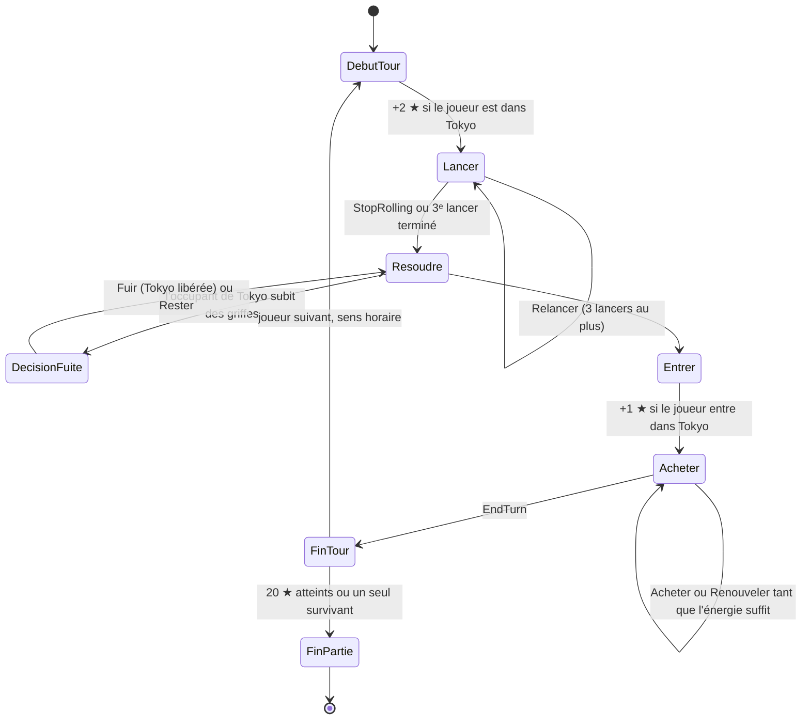

# King of Tokyo — Spécifications du projet

## 1. Cadre du projet

| | |
| --- | --- |
| **Rendu** | lundi 16 novembre 2026, 17 h 00 |
| **Forme du rendu** | dépôt GitHub, enseignant invité (`3ieDavidMenager`) ; fichier `AUTHORS` avec les noms des membres ; spécifications v0 (wireframes et premières spécifications) ; tableur de répartition des tâches |
| **Suivi** | à la fin de chaque séance, un `git pull` suivi d'un build doit produire une application fonctionnelle montrant l'état du projet |
| **Durée** | 7 semaines (28 septembre → 16 novembre 2026) |
| **Support** | application Android, téléphone, **orientation paysage** |
| **Joueurs** | 4 — 1 humain, 3 bots |
| **Base de règles** | livret *King of Tokyo – Dark Edition* fourni sur Moodle |
| **Thème** | libre — retenu : **Néon Kaiju** (cyberpunk synthwave, voir §2) |

### Membres du groupe

- Darlin Canis KAPATA NGANKAM
- Adrien DEU
- Vanelle Ivanna TCHOUKA
- Ninon Carmene TSAFACK NGUEMEGNE

---

## 2. Thème retenu — Néon Kaiju

> *Des monstres bio-mécaniques se disputent une mégapole saturée de néons, une nuit de pluie. Dés en verre lumineux, effet de glitch à chaque dégât, bande-son synthwave.*

Cinq univers ont été proposés (document *Thèmes & wireframes – KoT.pdf*) : **Néon Kaiju**, **Série B atomique**, **Titans de l'Olympe**, **Mini-Monstres** et **Abysses**. Le groupe a retenu Néon Kaiju ; les wireframes de référence sont dans `wireframes/theme1-neon-kaiju.html`, en portrait et en paysage. Seule la version **paysage** est implémentée (§3).

### 2.1 Vocabulaire

Le thème ne renomme que ce que voit le joueur. Le **code garde les termes du livret** (`tokyo`, `energy`, `malice`, `shop`) : le vocabulaire Néon Kaiju vit uniquement dans les ressources `strings.xml` de `:app`. Changer de thème ne toucherait donc ni au moteur ni aux tests de règles.

| Livret | Néon Kaiju | Pourquoi ce terme |
| --- | --- | --- |
| Tokyo City | **La Tour centrale** | position dominante et exposée : on frappe tout le monde d'en haut, on se fait frapper par tous |
| Tokyo Bay | *Le Port* — non utilisé | zone réservée aux parties à 5-6 joueurs, hors périmètre |
| Énergie ⚡ | **Cellules** | des monstres bio-mécaniques se rechargent ; la monnaie devient une batterie |
| Méchanceté | **Surcharge** | une jauge qui monte jusqu'à des seuils critiques 3 / 6 / 10 ; les paliers deviennent des « pouvoirs débloqués » |
| Cartes Énergie | **Marché noir** | boutique clandestine de pièces et d'implants, cohérente avec l'univers cyberpunk |
| Tuiles Méchanceté | **Pouvoirs de Surcharge** | ex. *Court-circuit*, *Arc électrique* |

### 2.2 Monstres

Six monstres originaux, dont un est choisi par le joueur et trois sont tirés au sort pour les bots : **Voltrax** (reptile blindé qui se recharge sur les lignes à haute tension), **Mecha-Lynx**, **Hydrokor**, **Spectra**, **Ferrodon**, **Kilowatt**. Les monstres n'ont pas de pouvoir propre : ils se distinguent par leur visuel et leur couleur d'accent, conformément aux règles du livret.

### 2.3 Identité visuelle

| Élément | Valeur | Rôle |
| --- | --- | --- |
| Fond | `#0b0b14` | arrière-plan de tous les écrans |
| Surface | `#15152a` | panneaux, cartes, fiches adversaires |
| Rose néon | `#ff3d9a` | **action et sélection** : boutons, dé verrouillé, dégâts |
| Cyan néon | `#28e0ff` | **zones et ressources** : Tour centrale, Cellules |
| Texte | `#e9e7f5` | texte courant |
| Titres | **Orbitron** | noms de monstres, titres d'écran |
| Texte | **Rajdhani** | compteurs, descriptions de cartes, boutons |

Contrastes mesurés (WCAG) :

| Couple | Ratio | Usage autorisé |
| --- | --- | --- |
| texte `#e9e7f5` sur fond / surface | 16,1 / 14,7 | tout texte |
| cyan sur fond / surface | 12,3 / 11,3 | tout texte |
| rose sur fond / surface | 6,0 / 5,5 | tout texte |
| fond `#0b0b14` sur rose / cyan | 6,0 / 12,3 | **libellé des boutons pleins** |
| texte clair `#e9e7f5` sur rose | 2,7 | **interdit** — échoue au seuil de 4,5:1 |

Les boutons pleins portent donc un libellé sombre. Cette règle est vérifiée par les captures Paparazzi.

### 2.4 Pourquoi Néon Kaiju

1. **C'est le thème le plus fidèle à la *Dark Edition*.** Notre base de règles est l'édition sombre, avec sa jauge de Méchanceté ; une ambiance nocturne et agressive la prolonge naturellement, là où Mini-Monstres ou Titans de l'Olympe la contrediraient.
2. **Le vocabulaire explique les règles.** « Cellules » rend évident qu'on accumule l'énergie et qu'on la dépense ; « Surcharge » fait lire les paliers 3 / 6 / 10 comme des seuils de puissance ; « la Tour centrale » fait comprendre sans tutoriel pourquoi son occupant frappe tout le monde et encaisse toutes les attaques. Moins d'explications à l'écran, c'est un avantage en paysage, où la hauteur utile est d'environ 400 dp.
3. **Il simplifie l'écriture des 20 cartes.** Le registre technologique (blindage, drones, piratage, recalibrage) correspond directement aux opérations de l'interpréteur : `annulerDegat` devient un *Blindage réactif*, `changerFace` un *Piratage*, `rerollDice` un *Recalibrage*. Quand une carte ne rentre pas dans la grammaire, on la réécrit sans forcer le thème (voir §10).
4. **Il coûte peu à produire.** Le néon, c'est des formes vectorielles, des dégradés et des lueurs que Compose dessine lui-même. Pas besoin d'illustrations peintes (Titans), de trame comics et d'onomatopées dessinées (Série B) ni de modelage 3D de pâte à modeler (Mini-Monstres). Le temps économisé revient au moteur, qui est sur le chemin critique.
5. **Il sert la lisibilité du jeu.** Deux accents seulement, avec un sens fixe : rose = ce que je peux faire, cyan = où je suis et ce que je possède. Le glitch plein écran à chaque dégât rend visible ce que fait un bot (règle transverse n° 1, §9) : le joueur voit qui l'a touché, et de combien.
6. **Un thème sombre unique réduit le travail.** Une seule palette à maintenir et à tester, adaptée aux écrans OLED et à une partie de 20 minutes le soir. Les polices Orbitron et Rajdhani sont sous licence OFL : elles peuvent être embarquées dans l'APK.
7. **Il reste entièrement original.** Univers, noms de monstres, cartes et pouvoirs sont les nôtres ; rien n'emprunte au nom ni aux visuels de King of Tokyo, propriété d'IELLO.

**Les alternatives écartées :**

| Thème | Point fort | Raison de l'écarter |
| --- | --- | --- |
| Série B atomique | identité très forte | palette claire, onomatopées et trame comics coûteuses à illustrer ; disposition C (tiroir) pensée pour le portrait |
| Titans de l'Olympe | originalité, disposition paysage | s'éloigne du jeu de kaiju et de l'ambiance *Dark Edition* ; fond marbre clair, typographie à empattements peu lisible en petite taille |
| Mini-Monstres | accessible, familial | animations rebondissantes et rendu pâte à modeler coûteux ; ton opposé à la Méchanceté |
| Abysses | justifie l'absence de soin dans la zone centrale (« pression du Dôme ») | deuxième choix. Vocabulaire aquatique (Perles, Épaves) moins parlant pour des cartes d'énergie ; ambiance plus lente que le rythme du jeu |

### 2.5 Contraintes induites par le thème

- **Lueurs néon et `minSdk 29`** : `Modifier.blur` et `RenderEffect` n'existent qu'à partir de l'API 31. Sur Android 10 et 11, la lueur est dessinée par un dégradé radial dans `drawBehind`, sans flou. Les captures Paparazzi couvrent les deux rendus.
- **Glitch et accessibilité** : l'effet dure au plus 300 ms, n'est jamais la seule indication d'un dégât (le compteur ♥ s'anime aussi) et est **désactivé** quand le réglage système *Supprimer les animations* est actif.
- **Couleur jamais seule** : un dé verrouillé est rose *et* porte un cadenas ; la Tour occupée est cyan *et* affiche le nom de l'occupant.
- **Son** : boucle synthwave et effets courts, coupables séparément dans les réglages.

---

## 3. Spécifications techniques

### Plateforme

| Paramètre | Valeur | Justification |
| --- | --- | --- |
| `minSdk` | **29** (Android 10) | imposé par l'énoncé ; `java.time` natif, thème sombre système, stockage cloisonné |
| `targetSdk` / `compileSdk` | 36 | exigence Play Store, API récentes |
| Langage | Kotlin 2.2 | `value class`, `sealed interface`, sérialisation |
| JDK | **21** (toolchain Gradle) | LTS, aligné avec AGP 8.x |
| Build | Gradle 8.x + version catalog | dépendances centralisées dans `libs.versions.toml` |
| UI | Jetpack Compose + Material 3 | une seule description d'écran, pas de XML |
| Orientation | `landscape` verrouillée | `android:screenOrientation="landscape"` dans le manifeste |
| Sérialisation | kotlinx.serialization | état de partie en JSON versionné |
| Injection | Hilt | permet d'injecter un générateur aléatoire fixe en test |
| Persistance | DataStore (réglages) + fichier JSON (partie en cours) | pas de base de données nécessaire à ce périmètre |

### Modules

```
:app              application, navigation, thème
:core:model       types immuables (GameState, PlayerState, Die, Card…)
:core:engine      moteur de règles — Kotlin/JVM pur, zéro import android.*
:core:content     catalogue JSON des cartes et tuiles + interpréteur d'effets
:core:ai          politiques de décision des bots
:feature:game     écrans Compose
```

Règle d'or : `:core:engine` ne dépend d'aucune API Android. Il se teste en JVM, sans émulateur, et c'est ce qui rend le moteur vérifiable dans le temps imparti.

### Stratégie de test

Deux types de tests seulement.

| Type | Outil | Portée | Seuil |
| --- | --- | --- | --- |
| **Unitaire** | JUnit 5 | une règle = un test, nommé `RULE_xx_…` ; une carte ou une tuile = un test, nommé d'après son identifiant | 85 % de lignes sur `:core:engine`, 100 % des cartes et tuiles |
| **Graphique** | Paparazzi | capture de chaque écran, thème Néon Kaiju, 2 tailles, API 29 et 31+ (lueurs) | aucune différence de pixels |

### Déterminisme

Le générateur aléatoire est injecté, jamais instancié dans le moteur. Sa graine et son curseur font partie de `GameState`. Conséquences : une partie se rejoue à l'identique depuis sa graine, un bug se reproduit depuis le rapport, et les tests n'ont pas besoin de mock.

---

## 4. Périmètre — différences avec le livret

| Élément du livret | Statut | Raison |
| --- | --- | --- |
| Tokyo City | **Conservé** | lieu unique du jeu |
| Tokyo Bay | **Retiré** | réservé aux parties à 5-6 joueurs |
| 6 dés gris | **Conservés** | |
| 2 dés jaunes | **Retirés** | liés à des cartes non reprises — choix de périmètre à faire valider (§11) |
| 66 cartes Énergie | **Remplacées par 20 cartes** | effets programmables, écrites par nous |
| 10 tuiles Méchanceté | **Conservées, réécrites** | mécanique des paliers conservée, effets propres |
| Jetons Poison / Toupetit / Fumée | **Retirés** | liés à des cartes non reprises — choix de périmètre à faire valider (§11) |
| Variante à 2 joueurs | **Retirée** | la partie compte toujours 4 joueurs |
| Thème, noms, illustrations | **Originaux : Néon Kaiju** | le thème est libre (§2) ; le nom et les visuels de King of Tokyo appartiennent à IELLO |

---

## 5. Étapes de développement

### Phase 0 — Cadrage

- Dépôt GitHub, branches protégées, modèle d'issue et de PR ; enseignant (`3ieDavidMenager`) invité
- Fichier `AUTHORS` avec les noms des quatre membres
- Squelette Gradle : 6 modules, version catalog, `minSdk 29`, JDK 21
- CI GitHub Actions : ktlint, detekt, tests JVM, build debug à chaque push
- Hilt configuré, générateur aléatoire injectable
- **Livrable** : un dépôt qui compile et dont la CI est verte

### Phase 1 — Wireframes

Wireframes dans le thème Néon Kaiju, **tous en paysage**, avec le même squelette : adversaires à gauche, la Tour centrale au centre, dés et actions à droite. Référence : `wireframes/theme1-neon-kaiju.html` (le fichier contient aussi une version portrait, non implémentée).

| Écran | Contenu à poser |
| --- | --- |
| Accueil | nouvelle partie, reprendre, règles, réglages |
| Choix du monstre | 6 monstres, le joueur choisit, 3 bots tirés au sort |
| Jeu | les 3 adversaires, la Tour centrale, jauge de Surcharge, 6 dés, Relancer / Résoudre |
| Marché noir | 3 cartes visibles, Cellules, acheter / renouveler |
| Fuir ou Rester | attaquant, dégâts, PV restants, deux boutons |
| Palier de Surcharge | niveau atteint, pouvoirs disponibles |
| Fin de partie | classement des 4, statistiques, rejouer |

Deux contraintes de mise en page paysage à valider dès le wireframe : la hauteur utile est faible (≈ 400 dp), donc aucun écran ne défile verticalement, et les commandes principales restent sous le pouce droit.

- **Livrable** : 7 wireframes Néon Kaiju validés par le groupe, servant de référence à l'interface — *réalisé* (`wireframes/theme1-neon-kaiju.html`)

### Phase 2 — Moteur de règles — *chemin critique*

Développé en TDD : le test de la règle est écrit avant l'implémentation.

1. Types immuables de `:core:model`
2. Machine à états des 5 phases, `legalActions`, `reduce`
3. Phase de lancer : garder, relancer, arrêter
4. Résolution : points de victoire, Méchanceté et paliers, énergie, griffes, soins
5. Décision Fuir ou Rester, élimination
6. Entrée dans Tokyo
7. Achat, fin de tour, conditions de victoire
8. Journal de partie et rejeu depuis la graine

- **Livrable J1** : une partie complète se joue en ligne de commande, 45 règles testées

### Phase 3 — Contenu et effets

- Schéma JSON des cartes et tuiles, validé au build
- Interpréteur d'effets : 9 opérations, 9 déclencheurs, 7 cibles
- Parseur d'expressions de condition, sans évaluation dynamique
- Écriture des 20 cartes et des 10 tuiles, un test par identifiant

- **Livrable** : ajouter une carte ne demande que d'éditer un fichier JSON

### Phase 4 — Interface

- Thème Compose Néon Kaiju : palette et rôles des couleurs (§2.3), polices Orbitron et Rajdhani embarquées, thème sombre unique
- Chaînes d'interface en `strings.xml` avec le vocabulaire du thème (§2.1)
- Composant dé, verrouillable, animé
- Écran de jeu paysage, puis les six autres écrans
- Superposition du tour des bots, lisible et accélérable

- **Livrable J2** : partie jouable de bout en bout contre 3 bots

### Phase 5 — Bots

- Interface `BotPolicy`
- Fonction d'évaluation d'un état : points, PV, énergie, position
- Bot heuristique : choix des dés, des achats, des tuiles
- Décision Fuir ou Rester

### Phase 6 — Persistance

- Sérialisation versionnée de `GameState`, graine comprise
- Sauvegarde automatique après chaque action
- Reprise après rotation, mise en arrière-plan ou fermeture, y compris au milieu d'une décision

### Phase 7 — Finition et qualité

- Dés en verre lumineux, glitch sur les dégâts (repli sans flou sous l'API 31, coupé si les animations système sont désactivées), boucle synthwave, retour haptique
- Accessibilité : TalkBack, contraste 4,5:1, cibles de 48 dp, symboles lisibles sans couleur
- Captures Paparazzi de tous les écrans

- **Livrable J3** : version gelée

### Phase 8 — Rendu

Aucune nouvelle fonctionnalité. Dépôt final à jour et buildable, README, `AUTHORS`, spécifications et tableur de répartition des tâches à jour, scénario de démonstration, essais sur appareil réel. Cette phase absorbe les retards.

---

## 6. Machine à états du tour



| Phase | Actions légales | Notes |
| --- | --- | --- |
| **1 · Lancer** | `ToggleKeep`, `Reroll`, `StopRolling` | 3 lancers au plus, arrêt à tout moment |
| **2 · Résoudre** | `ResolveSymbols` (ordre au choix) | seule phase qui peut interrompre le joueur actif |
| **· Décision** | `Flee`, `Stay` | ouverte au seul occupant de Tokyo, s'il a été blessé |
| **3 · Entrer** | aucune | automatique et obligatoire si Tokyo est libre |
| **4 · Acheter** | `BuyCard`, `SweepShop`, `EndTurn` | boucle tant que l'énergie suffit |
| **5 · Finir** | aucune | effets de fin de tour, puis test de victoire |

`legalActions(state)` est l'unique source de vérité : l'interface comme les bots n'y puisent que ce qui est permis. Toute action hors phase lève `IllegalActionException` plutôt que d'être ignorée en silence.

La décision Fuir ou Rester vit dans un sous-état `PendingFleeDecision` porté par `GameState`, afin qu'une partie sauvegardée puisse être reprise au milieu de cette attente.

---

## 7. Règles du jeu

Toutes les règles du livret, avec leur identifiant de test. Les règles marquées *hors sujet* sont celles que nous retirons du périmètre (§4) ; elles gardent leur numéro pour que la liste reste comparable au livret.

Cette section emploie volontairement les termes du livret (Tokyo, énergie, Méchanceté), comme le code. Dans l'application, ils apparaissent sous leur nom Néon Kaiju (§2.1).

### 7.1 But du jeu

Incarner un monstre géant qui attaque Tokyo. On gagne de deux façons : **atteindre 20 points de victoire**, ou **être le dernier monstre en vie**. Un monstre meurt quand il tombe à 0 point de vie.

### 7.2 Matériel (adapté au projet)

- 4 monstres, chacun avec ses points de vie (♥, max 10) et ses points de victoire (★, max 20)
- 1 plateau : Tokyo, et la jauge de Méchanceté graduée de 0 à 10
- 6 dés à 6 faces : `1`, `2`, `3`, ⚡ énergie, 🐾 griffe, ♥ soin
- 20 cartes Énergie (POUVOIR ou ACTION)
- 10 tuiles Méchanceté : 4 au niveau 3, 4 au niveau 6, 2 au niveau 10
- Des éclairs d'énergie (⚡), en réserve illimitée

### 7.3 Mise en place

| ID | Règle |
| --- | --- |
| RULE-01 | Chaque monstre démarre à **10 ♥**, **0 ★**, **0 de Méchanceté**. |
| RULE-02 | Les 20 cartes sont mélangées ; les **3 premières** sont révélées face visible. |
| RULE-03 | Les tuiles sont empilées par niveau : **4 au niveau 3, 4 au niveau 6, 2 au niveau 10**. |
| RULE-04 | *Hors sujet : Tokyo Bay, seconde zone utilisée à 5-6 joueurs.* |
| RULE-05 | Le premier joueur est celui qui obtient le plus de 🐾 à un lancer initial ; en cas d'égalité, les ex aequo relancent entre eux. |

Tokyo est **vide** au début de la partie. Le jeu se déroule dans le sens horaire.

### 7.4 Déroulement d'un tour

Un tour comporte cinq phases, dans cet ordre : **lancer les dés**, **résoudre les dés**, **entrer dans Tokyo**, **acheter des cartes**, **finir son tour**.

#### Phase 1 — Lancer les dés

| ID | Règle |
| --- | --- |
| RULE-06 | Le joueur dispose de **3 lancers au maximum** et peut s'arrêter à tout moment. |
| RULE-07 | *Hors sujet : dés jaunes supplémentaires. Le jeu utilise toujours 6 dés.* |
| RULE-08 | Avant un lancer, le joueur peut **reprendre** des dés qu'il avait mis de côté lors d'un lancer précédent. |

Le premier lancer utilise les 6 dés. Pour les lancers suivants, le joueur choisit lesquels relancer ; les autres restent de côté.

#### Phase 2 — Résoudre les dés

Seuls comptent les symboles présents **après le dernier lancer**.

| ID | Règle |
| --- | --- |
| RULE-09 | Le joueur résout ses symboles **dans l'ordre de son choix**. |

**Points de victoire (`1`, `2`, `3`)**

| ID | Règle |
| --- | --- |
| RULE-10 | Un **triple** du chiffre *n* rapporte *n* points de victoire. `1-1-1` → +1 ★, `2-2-2` → +2 ★, `3-3-3` → +3 ★. |
| RULE-11 | Chaque dé **au-delà des trois premiers** du même chiffre rapporte **1 ★ de plus**. `1-1-1-1` → +2 ★ ; `2-2-2-2-2` → +4 ★. |

Moins de trois dés d'un même chiffre ne rapportent rien.

**Méchanceté**

| ID | Règle |
| --- | --- |
| RULE-12 | Un triple de `1` rapporte **2 points de Méchanceté** ; un triple de `2` en rapporte **1**. |
| RULE-13 | Les `3` ne rapportent **aucun** point de Méchanceté. |
| RULE-14 | Quand le pion **atteint ou dépasse** les niveaux **3, 6 ou 10**, le joueur prend une tuile de ce niveau, au choix parmi celles encore disponibles. |
| RULE-15 | Un joueur détient **au plus une tuile par niveau**. Le pion ne recule jamais ; repasser un palier déjà franchi ne donne rien. |

Les dés supplémentaires au-delà du triple ne donnent pas de Méchanceté supplémentaire : `1-1-1-1` rapporte 2 points de Méchanceté, pas 3.

**Énergie (⚡)**

| ID | Règle |
| --- | --- |
| RULE-16 | Chaque ⚡ obtenu donne **1 éclair d'énergie**, conservé devant le joueur jusqu'à dépense. |

**Griffes (🐾)**

| ID | Règle |
| --- | --- |
| RULE-17 | Le monstre **qui occupe Tokyo** fait perdre 1 ♥ par 🐾 à **tous les autres monstres**. |
| RULE-18 | Un monstre **hors de Tokyo** fait perdre 1 ♥ par 🐾 **au seul occupant de Tokyo**. Les monstres hors de Tokyo ne se blessent jamais entre eux. |
| RULE-19 | L'occupant blessé choisit alors de **Fuir Tokyo** ou d'**y rester**. Dans les deux cas, il **perd les ♥**. |
| RULE-20 | On ne peut fuir que si la blessure vient **d'un autre monstre**. Une perte de ♥ causée par une carte n'ouvre pas la fuite. |
| RULE-21 | Au premier tour, Tokyo est vide : les 🐾 du premier joueur ne touchent personne. |

S'il fuit, Tokyo devient libre ; le monstre qui l'a blessé y entre lors de sa phase 3 (il vient de jouer, donc ce sera au tour suivant) ou, plus exactement, le prochain joueur dont la phase 3 trouve Tokyo libre.

**Soins (♥)**

| ID | Règle |
| --- | --- |
| RULE-22 | **Hors de Tokyo**, chaque ♥ obtenu rend **1 point de vie**, sans jamais dépasser **10 ♥**. |
| RULE-23 | **Dans Tokyo**, les ♥ des dés **ne soignent pas**. Seules les cartes et les tuiles peuvent y soigner. |

**Élimination**

| ID | Règle |
| --- | --- |
| RULE-24 | À **0 ♥**, le monstre est éliminé : ses cartes POUVOIR, ses tuiles et son énergie sont défaussées. S'il occupait Tokyo, Tokyo devient libre. |

#### Phase 3 — Entrer dans Tokyo

| ID | Règle |
| --- | --- |
| RULE-25 | Si Tokyo est **libre**, le joueur **doit** y entrer et gagne **1 ★**. |
| RULE-26 | On ne peut **pas** quitter Tokyo pendant cette phase. On n'en sort qu'en étant blessé par un autre monstre (RULE-19). |
| RULE-27 | *Hors sujet : entrée obligatoire en Tokyo Bay à 5-6 joueurs.* |
| RULE-28 | *Hors sujet : fermeture de Tokyo Bay dès qu'il reste 4 joueurs ou moins.* |
| RULE-29 | Un joueur qui **commence son tour** dans Tokyo gagne **2 ★**. |
| RULE-30 | *Hors sujet : variante à 2 joueurs.* |

**Avantages et inconvénients de Tokyo**, à retenir :

- `+1 ★` en y entrant, `+2 ★` au début de chaque tour qu'on y commence
- ses 🐾 touchent les trois autres monstres à la fois
- il ne peut pas se soigner avec les dés
- il encaisse toutes les attaques des autres

#### Phase 4 — Acheter des cartes

| ID | Règle |
| --- | --- |
| RULE-31 | Le joueur peut acheter **une ou plusieurs** des 3 cartes face visible, en payant leur prix en ⚡. Chaque carte achetée est **immédiatement remplacée** par la première carte de la pioche, disponible dans le même tour. |
| RULE-32 | Le joueur peut dépenser **2 ⚡** pour défausser les 3 cartes visibles et en révéler 3 nouvelles. |
| RULE-33 | Les cartes **POUVOIR** restent devant le joueur jusqu'à la fin de la partie. Les cartes **ACTION** sont résolues immédiatement, puis défaussées. |

Achats et renouvellements peuvent s'enchaîner tant que le joueur a l'énergie nécessaire.

#### Phase 5 — Finir son tour

| ID | Règle |
| --- | --- |
| RULE-34 | Les effets de cartes qui se déclenchent en fin de tour sont résolus, puis la victoire est testée. Le tour passe ensuite au joueur de gauche. |

### 7.5 Fin de partie

| ID | Règle |
| --- | --- |
| RULE-35 | La partie s'arrête à la fin du tour où un monstre atteint **20 ★**, ou quand il ne reste **qu'un seul monstre en vie**. |
| RULE-36 | Un monstre peut atteindre 20 ★ et mourir dans le même tour : il faut **être vivant** à la fin du tour pour gagner. |
| RULE-37 | Si tous les monstres sont éliminés en même temps, **personne ne gagne**. |

### 7.6 Précisions sur les cartes et les tuiles

| ID | Règle |
| --- | --- |
| RULE-38 | Aucune carte ne peut soigner **au-delà de 10 ♥**, sauf si son texte le précise explicitement. |
| RULE-39 | *Hors sujet : départage entre deux exemplaires d'Opportuniste.* |
| RULE-40 | *Hors sujet : jetons Poison et Toupetit.* |
| RULE-41 | *Hors sujet : défausse de jetons depuis Tokyo.* |
| RULE-42 | *Hors sujet : Métamorphose et revente de cartes.* |
| RULE-43 | *Hors sujet : Adaptation et copie de cartes.* |
| RULE-44 | Une carte peut viser les **deux voisins** du joueur actif, même s'ils se trouvent dans Tokyo. |
| RULE-45 | Les 10 tuiles Méchanceté sont **réécrites avec nos propres effets** : la mécanique des paliers est conservée, le thème est libre. |

---

## 8. Données de contenu et langage d'effets

20 cartes et 10 tuiles ne deviennent pas 30 classes Kotlin. Chaque effet est une **donnée** interprétée par le moteur : ajouter une carte revient à éditer un fichier JSON, sans recompiler.

### Format d'une carte

```json
{
  "id": "blindage_reactif",
  "nom": "Blindage réactif",
  "cout": 4,
  "type": "POUVOIR",
  "texte": "Le premier dégât que vous subissez à chaque tour est ignoré.",
  "effets": [
    {
      "declencheur": "AVANT_DEGAT_SUBI",
      "condition": "degatsSubisCeTour == 0",
      "cible": "SOI",
      "operation": "annulerDegat",
      "valeur": 1
    }
  ]
}
```

### Grammaire

| Champ | Valeurs autorisées |
| --- | --- |
| `declencheur` | `ACHAT`, `DEBUT_TOUR`, `AVANT_LANCER`, `APRES_RESOLUTION`, `AVANT_DEGAT_SUBI`, `APRES_DEGAT_INFLIGE`, `ENTREE_TOKYO`, `FIN_TOUR`, `PERMANENT` |
| `condition` | expression booléenne sur `GameState`, sous-ensemble figé, **parsée au chargement** (jamais d'`eval`) |
| `cible` | `SOI`, `ACTIF`, `TOUS`, `AUTRES`, `OCCUPANT`, `HORS_TOKYO`, `VOISINS` |
| `operation` | `gainVp`, `gainEnergy`, `gainHp`, `dealDamage`, `annulerDegat`, `modifyCost`, `rerollDice`, `changerFace`, `setFlag` |
| `valeur` | entier ou expression ; les valeurs négatives sont autorisées (`gainHp: -1`) |

Les tuiles suivent le même schéma avec un champ de plus : `niveau` (3, 6 ou 10).

Deux opérations du jeu d'origine disparaissent avec les jetons et les dés jaunes : `addToken` et `addDice`. Elles sont remplacées par `annulerDegat` et `changerFace`, qui couvrent les mêmes intentions de design sans ajouter de matériel.

### Répartition visée des 20 cartes

| Nombre | Famille | Opérations mobilisées |
| --- | --- | --- |
| 6 | combat et défense permanents | `dealDamage`, `annulerDegat` |
| 4 | économie d'énergie et coût des cartes | `gainEnergy`, `modifyCost` |
| 4 | manipulation des dés | `rerollDice`, `changerFace` |
| 3 | actions immédiates à effet fort | `gainVp`, `dealDamage` |
| 3 | effets déclenchés (entrée dans Tokyo, fin de tour) | `gainVp`, `gainHp`, `setFlag` |

### Validation au build

Un test unitaire du catalogue échoue si : le catalogue ne compte pas exactement 20 cartes et 10 tuiles, un identifiant est dupliqué, une opération, une cible ou un déclencheur est inconnu, ou une carte n'a pas de test nommé d'après son identifiant. C'est la garantie que les 20 effets sont réellement couverts le jour du rendu.

---

## 9. Contrat des écrans

Tous les écrans sont en **paysage**. Chaque écran est un composable sans état, alimenté par un `UiState` et remontant des `UiEvent`. Un écran ne calcule **jamais** une règle : si une information manque à son `UiState`, c'est le moteur qui doit la produire.

| Écran | Composable | `UiState` | `UiEvent` |
| --- | --- | --- | --- |
| 01 Accueil | `HomeScreen` | partie reprenable, version | `NewGame`, `Resume`, `OpenRules`, `OpenSettings` |
| 02 Choix du monstre | `MonsterPickerScreen` | 6 monstres, celui du joueur, les 3 bots | `PickMonster`, `StartGame` |
| 03 Jeu | `GameScreen` | `dice`, `rollsLeft`, `me`, `opponents` (3), `tokyo`, `malice`, `legalActions` | `ToggleKeep`, `Reroll`, `StopRolling`, `OpenShop`, `EndTurn` |
| — Tour d'un bot | `BotTurnOverlay` | nom du bot, action en cours, dés visibles | lecture seule + « accélérer » |
| 04 Marché noir | `ShopSheet` | 3 cartes, Cellules, coût réel après réduction | `BuyCard`, `SweepShop`, `CloseShop` |
| 05 Fuir ou Rester | `FleeDialog` | attaquant, dégâts, ♥ restants, conséquences | `Flee`, `Stay` |
| 06 Palier de Surcharge | `MalicePickerSheet` | niveau atteint, pouvoirs disponibles et détenus | `PickTile` |
| 07 Fin de partie | `GameOverScreen` | classement des 4, cause de fin, statistiques, graine | `Replay`, `BackHome` |

### Disposition paysage

```
┌──────────────┬───────────────────────────┬──────────────┐
│ Adversaire 1 │                           │  Lancer 2/3  │
│ Adversaire 2 │      TOUR CENTRALE        │  ⚀ ⚁ ⚂ ⚃ ⚄ ⚅ │
│ Adversaire 3 │        (occupant)         │              │
├──────────────┼───────────────────────────┤  Relancer    │
│ Moi ♥ ★ ⚡    │  Surcharge 0──3──6──10    │  Résoudre    │
└──────────────┴───────────────────────────┴──────────────┘
```

### Règles transverses

1. **Le tour d'un bot doit être lisible** : chaque action est montrée avec une pause d'au moins 400 ms. Sans cela, le joueur voit ses ♥ baisser sans comprendre pourquoi, et le correcteur ne peut pas vérifier que les bots suivent les règles.
2. **Un bouton désactivé explique pourquoi** au toucher long — « Il vous faut 2 ⚡ pour renouveler les cartes ». Une action grisée sans raison est lue comme un bug.
3. **Aucun défilement vertical** : la hauteur utile en paysage est d'environ 400 dp, tout doit tenir à l'écran.
4. **`legalActions` est la seule source** de l'activation des commandes.
5. **Cibles tactiles ≥ 48 dp**, étiquettes TalkBack sur chaque dé et chaque carte, symboles de dés distinguables sans la couleur.
6. **Aucune décision n'est prise à la place du joueur** : Fuir ou Rester attend sa réponse sans limite de temps. Le compte à rebours est une option des réglages, désactivée par défaut et ignorée quand TalkBack est actif.

---

## 10. Risques techniques

| Risque | Signal d'alerte | Parade |
| --- | --- | --- |
| Le moteur n'est pas fini à J1 | la décision Fuir/Rester non terminée à l'approche de J1 | geler le contenu à 12 cartes, brancher l'interface sur ce qui existe |
| Les bots ne respectent pas les règles | un bot tente une action hors phase (`IllegalActionException`) | les bots ne choisissent que dans `legalActions` : ils ne peuvent structurellement pas tricher |
| Les 20 cartes ne rentrent pas dans l'interpréteur | plus de 3 cartes exigeant une opération nouvelle | réécrire la carte plutôt qu'élargir le catalogue — le thème est libre, donc l'effet aussi |
| L'interface déborde le temps prévu | écran de jeu non jouable à J2 | couper la phase 7 en entier : un jeu laid mais juste vaut mieux que l'inverse |
| La mise en page paysage ne tient pas | un écran qui défile ou déborde sur un téléphone compact | figer la grille à 3 colonnes dès le wireframe, tester sur 2 tailles avant la phase 4 |
| Un bug de règles n'est pas reproductible | un rapport sans graine ni journal | la graine et la liste des actions sont jointes à chaque partie |
| Le tour des bots est illisible | un testeur ne sait pas expliquer pourquoi il a perdu des ♥ | pause de 400 ms par action, journal de tour dépliable |
| Les effets néon ralentissent l'écran de jeu | moins de 60 images/s sur un téléphone d'entrée de gamme | lueurs précalculées, glitch limité à 300 ms, aucun flou sous l'API 31 |
| Le thème nuit à la lisibilité | un libellé clair posé sur le rose, ou un état porté par la seule couleur | libellés sombres sur boutons pleins (§2.3), icône + couleur pour chaque état, contrôle Paparazzi |
| Le rendu est incomplet le 16 à 17 h | une tâche encore ouverte à J3 | version gelée à J3 ; la phase de rendu ne sert qu'aux essais et au README |

---

## 11. Points tranchés et questions ouvertes

### Décisions prises

- [x] **Thème** : Néon Kaiju (§2).
- [x] **Tuiles Méchanceté conservées** : le cours publie une ressource dédiée (« KoT Wickedness tiles ») à côté des règles, et l'énoncé ne les exclut pas. RULE-14, RULE-15 et RULE-45 restent dans le périmètre, en attendant la confirmation de l'enseignant.
- [x] **Nombre de cartes** : l'énoncé demande « une vingtaine » (20-ish). Nous fixons **20**, et le test unitaire du catalogue vérifie ce nombre exact pour détecter une carte oubliée.
- [x] **Bots** : un seul comportement, simple et conforme aux règles, pour les 3 bots. Pas de niveaux de difficulté : ils ne sont pas demandés.
- [x] **Forme du rendu** : le dépôt GitHub, sans APK signé (§1).
- [x] **Délai sur Fuir ou Rester** : **aucun délai par défaut**. Le choix revient au joueur ; le compte à rebours du wireframe est un ajout d'interface, facultatif, activable dans les réglages et coupé automatiquement quand TalkBack est actif (§9, règle 6).
- [x] **Libellés de la jauge de Surcharge** : ils annoncent un choix de tuile (« Palier 3 : choisir un pouvoir »), pas un effet fixe, conformément à RULE-14. L'écran 06 du wireframe, qui affiche une récompense fixe par palier, doit être corrigé.

### À demander à l'enseignant (un seul message)

- [ ] **Tuiles Méchanceté** : confirmer qu'elles sont attendues. Le PDF fourni ne contient que des images.
- [ ] **Jetons et dés jaunes** : leur exclusion (§4, RULE-07, RULE-40, RULE-41) ne figure pas sur la page du cours. Retrouver la source de cette exclusion, ou faire valider que c'est un choix de périmètre acceptable.
